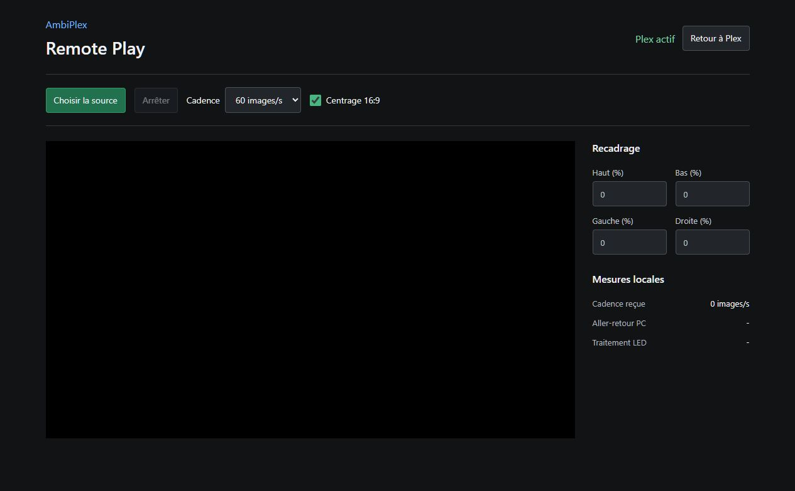
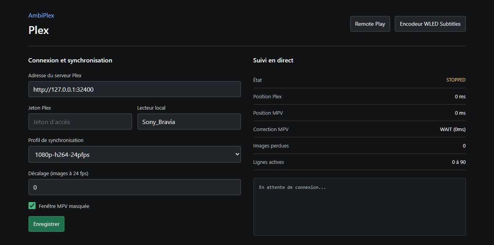
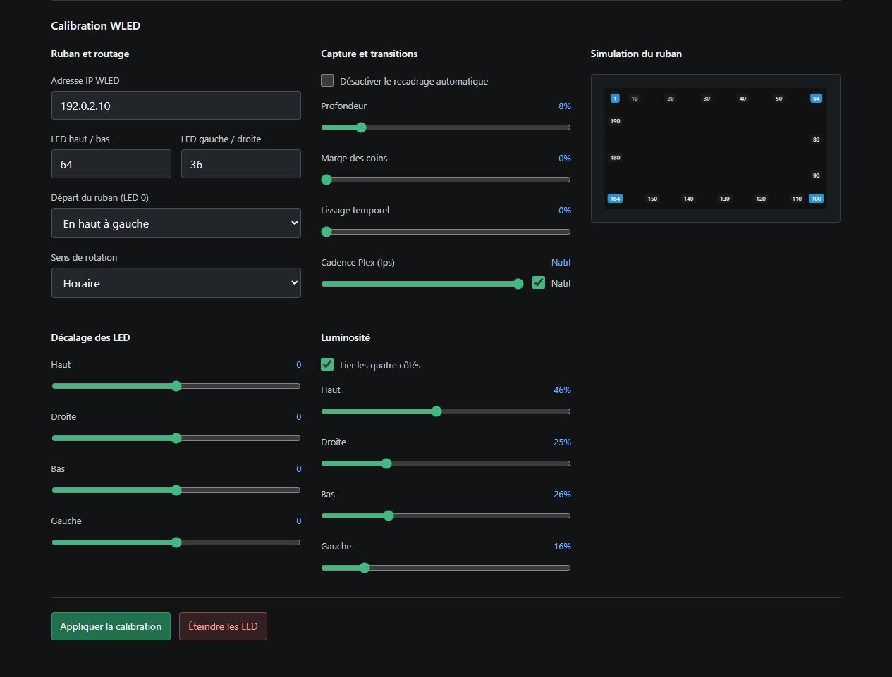
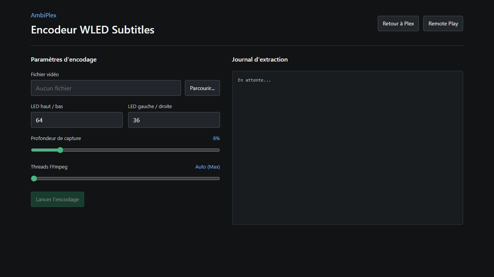

# AmbiPlex - Plex, Xbox Series X|S, PS4 & PS5

**Real-time WLED ambient lighting for your movies and games.**

AmbiPlex follows local Plex playback or reads a console's Remote Play image on
your PC. Your console stays connected directly to the TV, while the same LED
engine handles color sampling, brightness, smoothing and strip layout.

**No HDMI splitter. No capture card. No preencoding required.**
WLED Subtitles are an optional optimization for Plex movies, never a requirement.

## Choose Your Setup

| Source | Setup guide | Validation |
| --- | --- | --- |
| Xbox Series X\|S | **[Xbox setup](XBOX_SETUP.md)** | Series X tested; Series S supports Xbox Remote Play but has not been tested here. |
| PS4 / PS5 | **[PlayStation + Chiaki-ng setup](PLAYSTATION_SETUP.md)** | PS4 working in Chrome; PS5 not yet physically tested. PS4 color calibration is ongoing. |
| Plex | **[Plex playback](#plex-playback)** | Real-time MPV rendering or optional precomputed tracks. |

The console guides cover connection, controller setup, capture and troubleshooting.
An active Plex session is **not required** for console lighting.
Standard PS4/PS5 setup does **not require a jailbreak**.

## Highlights

- Live console capture with a 30/60 fps target and adjustable framing.
- Automatic local Plex synchronization with a selected master player.
- Per-side brightness, black-bar detection, smoothing and LED routing.
- A live LED simulator, shared web interface and **Retour à Plex** control.
- Optional web and Rover batch encoders for WLED Subtitles.

Controls and logs are in French. Use **Chrome for console capture**; the PS4
capture froze in Firefox during testing while Chiaki remained connected.

## Installation

You need Windows, Python 3.11 (tested), a WLED controller and addressable LEDs
reachable from the PC. Plex also needs accessible video paths; console-specific
requirements are in the guides above.

1. Clone the repository and open a terminal in its directory.
2. Create the environment: `python -m venv venv`.
3. Install dependencies: `venv\Scripts\python.exe -m pip install -r requirements.txt`.
4. Place the 64-bit `libmpv-2.dll` at the project root; `download_mpv.py` can
   download it. MPV is currently an installation dependency even for console mode.
5. Start using **one method**: `start.bat` or your Python service manager.
6. Open [AmbiPlex](http://localhost:5777), enter the WLED address and LED layout,
   then apply the calibration. Continue with your source's setup guide.

**Using PyManager?** Select `venv\Scripts\python.exe`, script `web.py`, and the
project directory as the working directory. Use its Start/Stop controls; do not
launch another copy with `start.bat`. AmbiPlex uses port **5777**.

After upgrading, reinstall requirements and restart through the same manager
for Python changes. Reload the browser for interface changes; reloading an
active capture ends sharing and requires selecting the source again.

## Plex Playback

1. Enter your Plex server address and token in the dashboard.
2. Set **Lecteur local** to the player name reported by Plex.
3. Start a movie on that player and adjust LED settings or synchronization offset.

MPV extracts colors automatically, with no extra media files. Names ignore case,
underscores and extra whitespace: `Sony_Bravia` matches `Sony Bravia`.
With a master selected, AmbiPlex waits for it; an empty name enables automatic
selection among verified local video sessions. Remote/relayed Plex sessions are
excluded, independently of user-selected console capture.

### Optional WLED Subtitles

Precompute movie colors to reduce playback decoding work. Open the web encoder
or launch `start_rover.bat` to scan, filter and encode videos in batches.
FFmpeg is needed only for this optional step, not ordinary playback or capture.

Generated `Film.wledsub.lz4` files sit beside their videos. LED dimensions must
match; changes to capture depth or baked black-bar processing require reencoding.
Missing/incompatible tracks fall back to MPV. See the
[WLED Subtitles reference](architecture_WLED_subs.md) for CLI usage, Rover and format details.

## Limits and Security

- The current DDP sender supports up to **480 LEDs**; larger layouts are truncated.
- TV video modes, lighting latency and color accuracy depend on the setup.
  Series X testing retained TV Dolby Vision with no perceptible lighting delay;
  this is an observation, not a universal guarantee or instrumented measurement.
- Keep the server on a trusted network: the dashboard has **no application authentication**.
- `config.json` contains local settings and the Plex token and is ignored by Git.
  Keep console account IDs, pairing codes and client credentials out of commits too.

## Reference

- [Architecture and runtime behavior](architecture.md)
- [Tests and validation results](tests/README.md)
- [Changelog](changelog.md)

Interface screenshots

Captured September 14, 2026, before the console-source selector was added.
Pages are idle; the Plex token is omitted and the WLED address is an example.

Designed by Sébastien Bédard.
